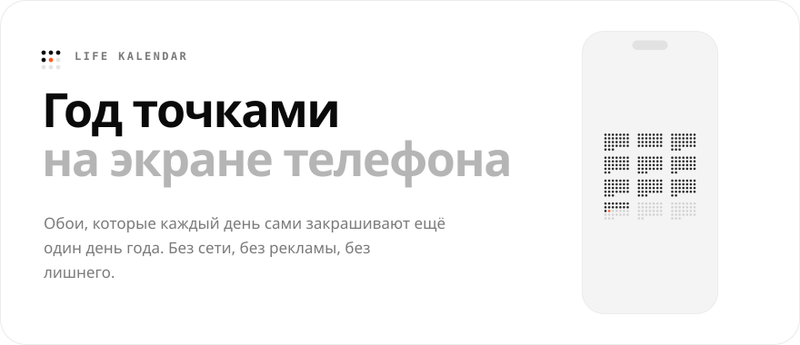
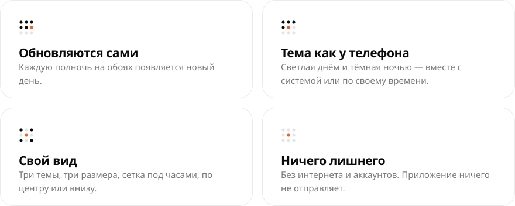
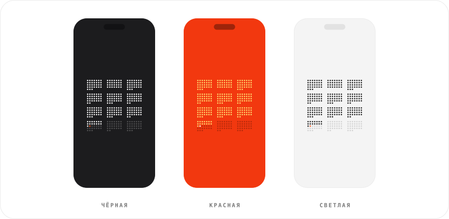
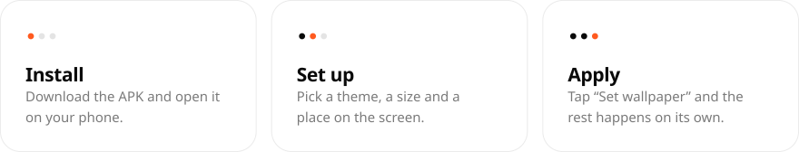

<p align="center">
  
</p>

<p align="center">
  <a href="https://github.com/sailxx/LifeKalendar/releases/latest/download/LifeKalendar.apk"></a>
</p>

<p align="center">
  
</p>

<p align="center">
  
</p>

<p align="center">
  
</p>

<details>
<summary>Сборка</summary>

```bash
./gradlew assembleRelease
```

APK — в `app/build/outputs/apk/release/`. Плашки README: `cd tools/readme && npm install && node build.mjs` (шрифты `golos.ttf` и `jbmono.ttf` в `tools/readme/.font/`), тексты — в `tools/readme/strings.json`.

</details>
